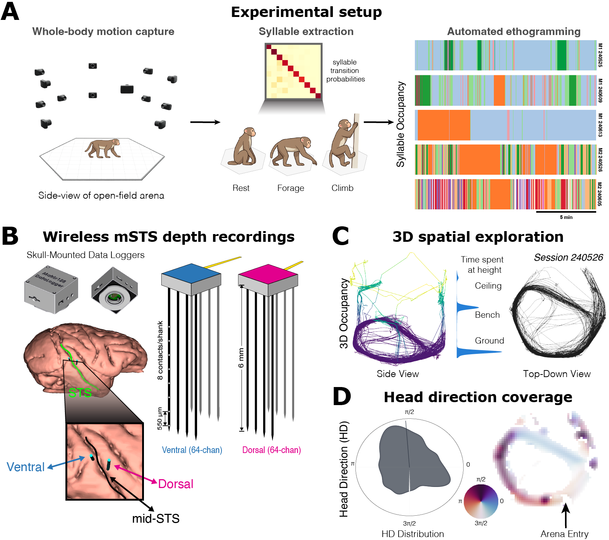

# solo_mSTS_parodi2026

Analysis code for: **Mid-superior temporal sulcus encodes spatial context and behavioral state in freely moving macaques**

Parodi et al. (2026)



> **Abstract.** Primate neuroscience has traditionally studied the brain under highly constrained conditions, limiting our understanding of neural function during real-world behavior. The mid-superior temporal sulcus (mSTS) is implicated in social perception, but its role during unconstrained behavior has not been tested. Here we performed wireless depth-electrode recordings from both banks of mSTS in macaques freely exploring a large three-dimensional arena, combined with 3D pose tracking and behavioral segmentation. Neural encoding models revealed mSTS firing rates were jointly modulated by spatial position, body kinematics, and geometric visual proxies, preferentially encoded in allocentric coordinates but with a shift toward body-centric encoding during vertical exploration. Neural populations carried decodable information about discrete behavioral syllables, with broad temporal generalization and neural similarity that tracked the sequential structure of behavior. Population manifold analysis revealed that the same behavior occupied different regions of population space at different spatial locations, and population dynamics showed structured organization around behavioral transitions. Together, these results suggest that mSTS populations carry joint information about spatial context and behavioral state during natural behavior.

## Overview

This repository contains the complete analysis pipeline for reproducing all quantitative results (Figs 2-5) from neural and behavioral data. Two rhesus macaques (M1, M2) were recorded with wireless 128-channel arrays in mid-STS while freely navigating a hexagonal arena. The pipeline covers encoding models, reference frame analysis, behavioral motif decoding, and CEBRA manifold analysis.

## Installation

```bash
git clone https://github.com/felipe-parodi/solo_mSTS_parodi2026.git
cd solo_mSTS_parodi2026
pip install -e .
```

For GPU-accelerated CEBRA analysis (Fig 5):

```bash
pip install -e ".[gpu]"
# CEBRA v0.4.0 must be installed from source:
git clone https://github.com/AdaptiveMotorControlLab/CEBRA.git
cd CEBRA && git checkout v0.4.0 && pip install -e . && cd ..
```

## Data

Raw data and pre-computed results are available on [Zenodo (DOI: TBD)]().

After downloading, place files in the following layout:

```
data/                          # Raw data (per session)
  240525-M1/
    Neural_data_sorted_final.mat
    pose3d_smoothed.npz
    sync_map.json
  240526-M2/ ...
  240605-M2/ ...
  240609-M1/ ...
  240613-M1/ ...
  motifs/                      # Shared behavioral syllable labels
    ethogram_final.parquet
    clusters_summary.parquet
    frames_map.parquet

results/                       # Pre-computed analysis outputs
  production/                  # Encoding/decoding parquets (Figs 2-4)
  fig3_rf/                     # Reference-frame index results
  fig4_similarity/             # Neural-behavioral similarity
  fig5_cebra/                  # CEBRA manifold embeddings and results
```

## Quick Start: Notebooks

The easiest way to explore the results is through the Jupyter notebooks in `notebooks/`:

| Notebook | Figure | Description |
|----------|--------|-------------|
| `fig2_encoding.ipynb` | Fig 2 | Encoding model: unique variance decomposition |
| `fig3_reference_frames.ipynb` | Fig 3 | Reference frame preferences (allo/body/head) |
| `fig4_motif_decoding.ipynb` | Fig 4 | Behavioral motif decoding + transition analysis |
| `fig5_cebra_manifold.ipynb` | Fig 5 | CEBRA manifold: decoding, dynamics, context coding |

Each notebook has two parts:
- **Part A (Demo)**: Runs the analysis pipeline with minimal parameters (~1-5 min)
- **Part B (Production)**: Loads pre-computed results and generates publication figures

## Full Reproduction

To re-run analyses from raw data:

```bash
# Fig 2: Encoding model (M2 sessions, ~1h)
python scripts/run_fig2b_all_sessions.py \
    --output-dir results/production --sessions M2_0526 M2_0605 \
    --bin-s 0.5 --n-perm 100 --n-perm-null 500

# Fig 3: Reference frames (all sessions, ~1h)
python scripts/run_fig3_all_sessions.py

# Fig 4: Motif decoding (all sessions, ~2h)
python scripts/run_fig4_all_sessions.py \
    --output-dir results/production/fig4_all4 --n-perm 1000

# Fig 5: CEBRA manifold (all sessions, ~45min with GPU)
python scripts/run_fig5_cebra.py \
    --output-dir results/fig5_cebra --max-iterations 5000
```

## Repository Structure

```
solo_mSTS_parodi2026/
  freemat/single_fm/           # Core analysis modules
    data/                      #   Session loading, calibration, arena geometry
    encoding/                  #   Ridge regression, variance decomposition, decoding
    features/                  #   VIS, BODY_KIN, HEAD_KIN, POS features
    viz/                       #   Publication figure panels
  freemat_data/                # Data infrastructure (loaders, types, sync)
  analysis/                    # Decoding framework, syllable alignment
  scripts/                     # Runnable analysis pipelines
  notebooks/                   # Per-figure Jupyter notebooks
  configs/                     # Session configs, calibration JSONs, electrode banks
  tests/                       # Unit + smoke tests (123 passing)
```

## Sessions

| Session | Subject | Units (SUA + MUA) | Duration | FPS |
|---------|---------|-------------------|----------|-----|
| M2_0526 | M2 | 443 (321 + 122) | 40 min | 40 |
| M2_0605 | M2 | 400 (277 + 123) | 40 min | 40 |
| M1_0525 | M1 | 186 (86 + 100) | 31 min | 40 |
| M1_0609 | M1 | 191 (90 + 101) | 17 min | 30 |
| M1_0613 | M1 | 184 (86 + 98) | 37 min | 40 |

**Total**: 1,404 units (860 SUA + 544 MUA) across 5 sessions, 2 subjects.

## License

MIT. See [LICENSE](LICENSE).
